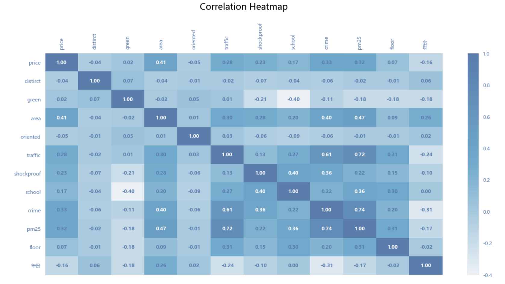
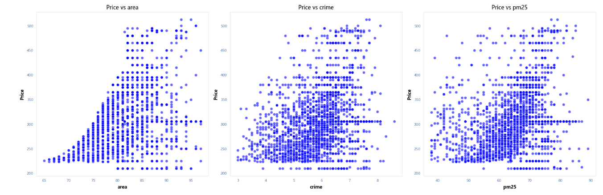
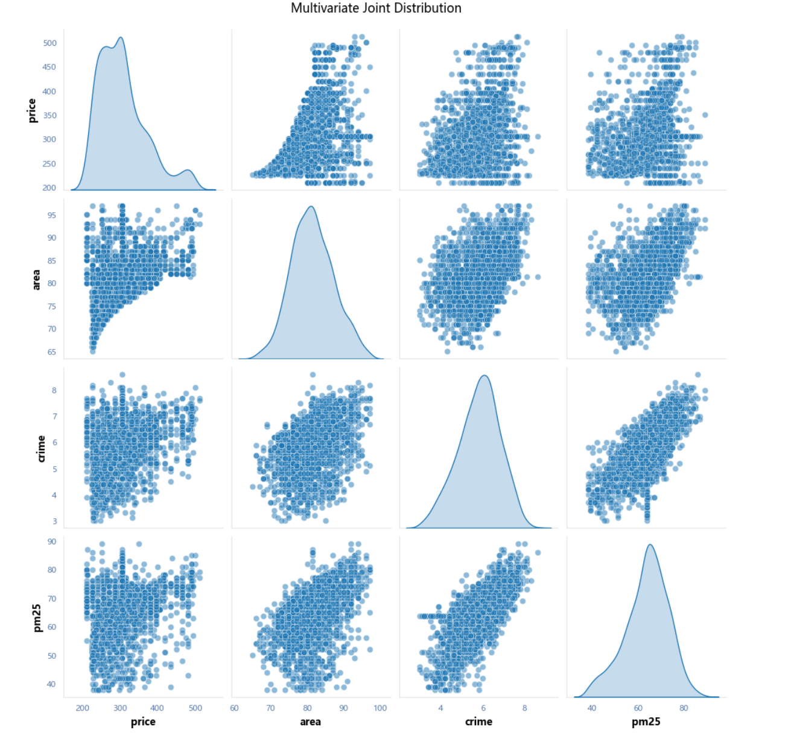

# Housing Price Data Analysis with Python
**English | [中文](./README.zh.md)**

## What this is
A Python data analysis pipeline on a 2,000-row housing dataset, covering missing-value handling, outlier detection, correlation analysis, and feature preparation for downstream modelling.

## Data

- **File**: `house_train.csv` (included in this repository, ~326 KB)
- **Rows**: 2,000
- **Source**: Originally obtained from a public Kaggle dataset. The original dataset page is no longer accessible, so the raw file is included here for reproducibility.

## What I did
- Cleaned missing values and implemented a reusable outlier-processing function based on Pearson normality tests with 3σ/IQR thresholds.
- Performed correlation analysis (Matplotlib/Seaborn) to identify area, crime rate, and PM2.5 as the top price-correlated features.
- Applied Z-score standardization and equal-width binning to price for downstream analysis.

## 📊 Visualizations

**1. Correlation Heatmap**

*Identified area, crime rate, and PM2.5 as the top price-correlated features.*

**2. Price vs. Top 3 Features**

*Scatter plots showing the relationship between the final price and the top 3 correlated features.*

**3. Multivariate Joint Distribution**

*Joint distribution of key variables to check for data density and potential outliers.*

## 📂 Files in this Repository
- `housing_price_analysis.ipynb`: The main Jupyter Notebook containing the analysis pipeline.
- `house_train.csv`: The raw dataset.
- `standardized_dataset.csv`: The processed dataset after Z-score standardization.
- `*.png`: The exported visualizations.

## 🛠️ Tools
Python (pandas, numpy, scipy, scikit-learn, matplotlib, seaborn)
