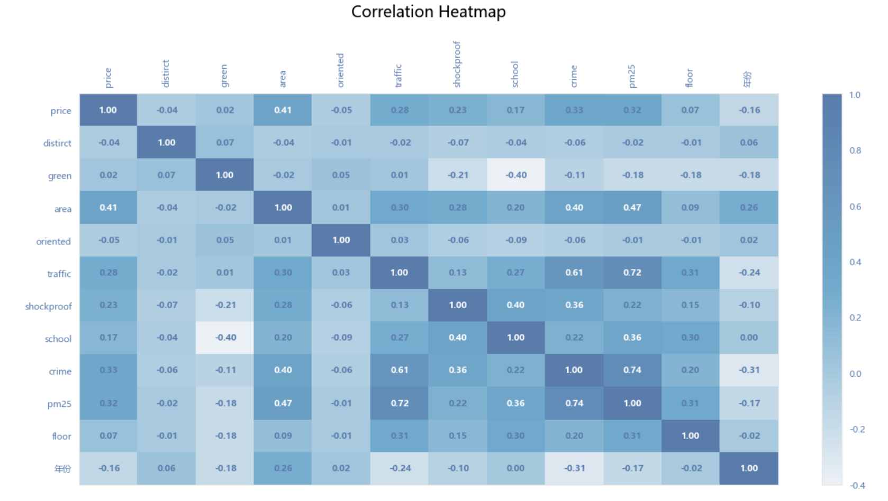
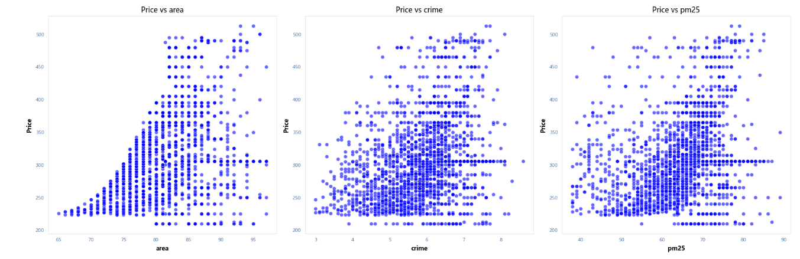
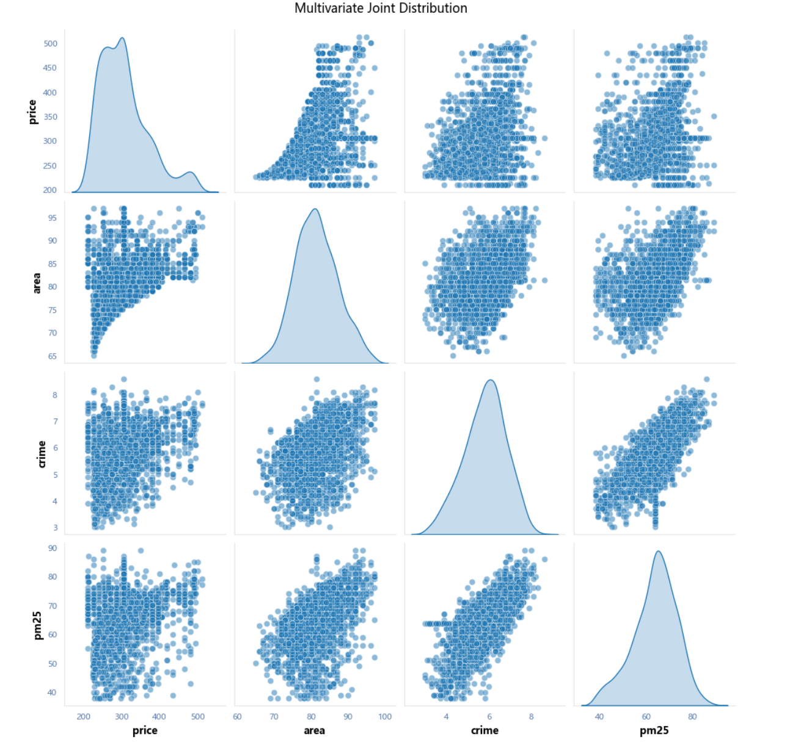

# 基于 Python 的房价数据分析
**[English](./README.md) | 中文**

## 项目简介
本项目是一个基于 2,000 行房价数据集的 Python 数据分析流水线，涵盖了缺失值处理、异常值检测、相关性分析，以及为下游建模（downstream modelling）准备特征。

## 数据集说明

- **文件**：`house_train.csv`（已包含在本仓库中，约 326 KB）
- **数据量**：2,000 行
- **来源**：最初获取自 Kaggle 的公开数据集。由于原数据集页面已失效，为了确保项目的可复现性（reproducibility），此处直接包含了原始数据文件。

## 我的工作
- **数据清洗与异常值处理**：清洗了缺失值，并实现了一个可复用的异常值处理函数（基于 Pearson 正态性检验，结合 3σ 和 IQR 阈值）。
- **相关性分析**：使用 Matplotlib/Seaborn 进行可视化分析，识别出房屋面积（area）、犯罪率（crime rate）和 PM2.5 是与房价相关性最高的特征。
- **特征准备**：对房价数据应用了 Z-score 标准化和等宽分箱（equal-width binning），以供后续建模分析使用。

## 📊 数据可视化

**1. 特征相关性热力图**

*识别出房屋面积、犯罪率和 PM2.5 是与房价相关性最高的特征。*

**2. 房价与前三大特征的关系图**

*展示了最终房价与前三个高相关性特征之间的散点图及趋势。*

**3. 多变量联合分布图**

*关键变量的联合分布情况，用于检查数据密度及潜在的异常值。*

## 📂 仓库文件说明
- `housing_price_analysis.ipynb`：包含完整分析流程的 Jupyter Notebook 文件。
- `house_train.csv`：原始数据集。
- `standardized_dataset.csv`：经过 Z-score 标准化处理后的数据集。
- `*.png`：导出的可视化图表。

## 🛠️ 工具
Python (pandas, numpy, scipy, scikit-learn, matplotlib, seaborn)
